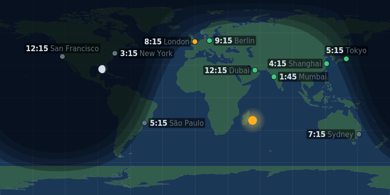
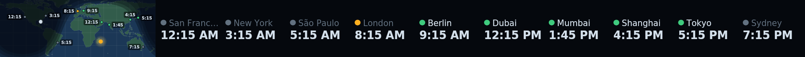
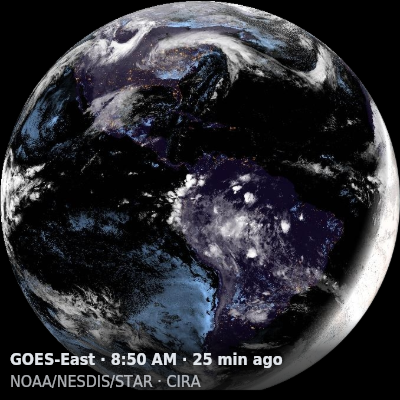
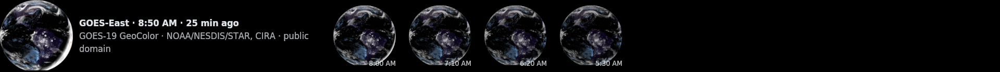
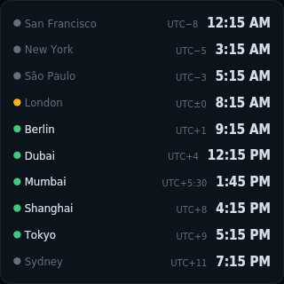

# kiosko-plugin-world

The planet now: a world map with day and night as they are (twilight in bands, the sun and the moon overhead) computed on your machine, your team’s cities with their time and whether they are at work, and the whole Earth as the weather satellites see it (GOES, Meteosat, Himawari), renewed every 10 minutes. Also an interlude: a day going round the Earth in a few seconds. No keys needed.

A plugin for [Kiosko](https://github.com/kiosko-lcd/kiosko), the widget mosaic for small USB LCD panels.









## Install

In Kiosko, **Plugins → Install from npm** → `kiosko-plugin-world`, then restart Kiosko. Or from a terminal:

```sh
npm install --prefix ~/.config/kiosko/plugins kiosko-plugin-world
```

(macOS: `~/Library/Application Support/Kiosko/plugins`, Windows: `%APPDATA%\Kiosko\plugins`.)

## Requirements

- Nothing for the map and the clocks: they are computed on your machine. For the satellite images, internet access to the satellite chosen (see *What it does on your machine*); no keys or accounts.

## What it does on your machine

- **Internet**: contacts `cdn.star.nesdis.noaa.gov`, `view.eumetsat.int`, `www.data.jma.go.jp`.

## Widgets

### Day and night — `world/map`

The world with day and night as they are now, twilight in bands, the sun and the moon where they are overhead, and your team’s cities with their local time and whether they are at work. A flat map or a globe; computed here, without network.


Uses: `world/team`.

| Option | Type | Default | |
|---|---|---|---|
| `projection` | `map` \| `globe` | `"map"` | Projection |
| `center` | `auto` \| `greenwich` \| `pacific` \| `here` | `"auto"` | Centred on. Automatic: Greenwich, unless you are far from it (the Americas, Asia, Oceania): then near you. Your place is the one in Settings, or your time zone’s. |
| `list` | boolean | `true` | Clocks beside the map. When the tile leaves room beside or under the map. |
| `labels` | boolean | `true` | Times on the map |
| `twilight` | boolean | `true` | Twilight bands. Civil, nautical and astronomical twilight as steps of darkness. Off: just day and night. |
| `showMoon` | boolean | `true` | The moon |

### Team clocks — `world/team`

Your team’s cities with their local time, sorted by time zone, and a dot for whether they are at work there now: green at work, amber about to start or just done, grey off (a ring on days off). Each city has its own hours and weekend.



Uses: `world/team`.

*No options.*

### The Earth now — `world/earth`

The whole Earth as a weather satellite sees it now (GOES, Meteosat or Himawari: the one over you), renewed every 10 minutes, with the satellite, the time and the agency’s credit on screen.


Uses: `world/earth`.

*No options.*

## Data sources

### Your team’s cities — `world/team`

The cities of your team, each with its time zone and working hours. Computed here; no network. Read every 10 min while a widget uses it. Options are set once in Kiosko → Settings → Data sources.

| Option | Type | Default | |
|---|---|---|---|
| `members` | list | `[]` | Cities. Where your team is: a city from the list (its time zone, place and usual working week come with it) or your own. Empty: a city on each continent. |

### The Earth from space — `world/earth`

The latest full-disk image of a weather satellite (GOES, Meteosat or Himawari), at the size your panels need, every 10 minutes at most. Kept on disk: if the satellite’s site is down, the last image stays. Read every 5 min while a widget uses it. Options are set once in Kiosko → Settings → Data sources.

| Option | Type | Default | |
|---|---|---|---|
| `satellite` | `auto` \| `goes-west` \| `goes-east` \| `meteosat` \| `meteosat-iodc` \| `himawari` | `"auto"` | Satellite. The one over you: the satellite hanging closest to your longitude (from your location in Settings, or your time zone). |

## Interludes

### A day around the Earth — `world/day`

A whole day in a few seconds: night and twilight sweep across the map or the globe while your team’s clocks run through the day; or the last hours of satellite images, one after another. Add it in Kiosko → Screens → Interludes.

| Option | Type | Default | |
|---|---|---|---|
| `show` | `auto` \| `map` \| `globe` \| `satellite` | `"auto"` | Show. Automatic: the satellite’s last hours on squarish panels when it has kept enough images; else the map on long panels and the globe on the rest. |
| `seconds` | number | `12` | Seconds |

## Day and night

Computed on your machine, no network. The sun's place uses NOAA's solar
calculator equations (Meeus; good to about 0.01° in declination and a few
seconds in the equation of time between 1800 and 2100), checked in the tests
against an independent ephemeris (astropy). The moon uses the Astronomical
Almanac's low-precision series (a few tenths of a degree), enough to put it
on the map with its phase.

- **Twilight in bands**: day while the sun's upper limb is up (−0.833°),
  then civil twilight to −6°, nautical to −12°, astronomical to −18°, then
  night, each a step darker. *Twilight bands* off: just day and night.
- **The sun and the moon** are drawn where they stand overhead (the
  subsolar and sublunar points); the moon with its phase.
- **The map**: equirectangular, centred on Greenwich unless you are far from
  it (the Americas, Asia, Oceania), or where you choose; on long strips it
  is cut to the latitudes where people live (78°N to 58°S) so it doesn't
  get squashed. Or a **globe** seen above your longitude.
- **The land** is Natural Earth's 1:50m land (public domain), simplified to
  0.15° and bundled (37 KB, see `scripts/land.mjs`).

## Your team

Set the cities once in **Settings → Data sources → Your team's cities**:
pick a city from the list (68 of them, with their names in English,
Spanish, German and Chinese, their time zone, place and usual working week)
or add your own (a name, an IANA time zone, and optionally where it is, for
its dot on the map). Each has its working hours (9:00–18:00 by default) and
working days: *as usual there* is Monday to Friday, but Sunday to Thursday
in Riyadh, Tel Aviv, Cairo and Dhaka, Saturday to Wednesday in Tehran, and
Sunday to Friday in Kathmandu; or choose. Night shifts (22:00–06:00) work
too. Summer time is the zone's own.

The dot says what is going on there now: **green** at work, **amber**
within the hour before starting or after finishing, **grey** off, a **grey
ring** on a day off. The clocks are sorted west to east, with `+1` or `−1`
where it is already tomorrow or still yesterday. No cities set: one on each
continent.

## The Earth from space

The **`world/earth`** source asks for the latest full-disk image of the
satellite chosen, or of the one hanging closest to your longitude (from
your location in Settings or, if none, your time zone):

| `satellite` | Over | Image | Where from |
|---|---|---|---|
| `goes-west` | 137.2°W (GOES-18): the Pacific, the western Americas | GeoColor (CIRA): true colour by day, city lights by night | NOAA/NESDIS/STAR, `cdn.star.nesdis.noaa.gov`, a fixed address per size (339, 678, 1808 px) |
| `goes-east` | 75.2°W (GOES-19): the Americas, the Atlantic | GeoColor | the same |
| `meteosat` | 0° (Meteosat-12, MTG-I1): Europe, Africa | GeoColour, with city lights by night | EUMETSAT's EUMETView map service (WMS, `view.eumetsat.int`), the latest time from the layer's capabilities |
| `meteosat-iodc` | 45.5°E (Meteosat-9): the Indian Ocean, India | Natural Colour Enhanced (dark at night) | the same |
| `himawari` | 140.7°E (Himawari-9): Asia, Oceania | True Color Reproduction (dark at night) | the Japan Meteorological Agency's real-time page (`www.data.jma.go.jp`), 601 px, the latest time from its list |

- **At most every 10 minutes** (the satellites renew their full disk every
  10 or 15 minutes), and an image is downloaded only when there is a new
  one: GOES with `If-Modified-Since` (a `304` costs nothing), JMA and
  EUMETSAT by the time they list. After a failure: 10, 20, 40 minutes… up
  to 2 hours.
- **At the panels' size**: each tile notes the disk it paints and the
  source asks for the smallest size that covers the largest of them
  (GOES 339/678/1808 px; EUMETSAT draws exactly what is asked). About
  300 KB an image at 678 px.
- **On disk**: the images of the last four hours are kept in Kiosko's cache
  folder (about 7 MB at 678 px) and the record of them; if the provider is
  down, the last image stays, with *not updated* after an hour.
- **As the satellite sees it**: EUMETView gives its images in latitude and
  longitude; the plugin turns them back into the satellite's view, so every
  satellite shows a full disk. NOAA's caption bar under GOES images and
  JMA's margins are cut off.

On long strips the disk sits beside its caption, followed by the images of
the hours before it (one every hour or so, as the source has kept them).

## Licences and credit

The satellite, the time of the image and the agency's credit are always on
screen, whole (wrapped, never cut): the long form where there is room, the
short one otherwise.

| Satellite | Shown as | Terms |
|---|---|---|
| GOES-East, GOES-West | **NOAA/NESDIS/STAR · CIRA** (long: *GOES-19 GeoColor · NOAA/NESDIS/STAR, CIRA · public domain*) | Works of the US federal government: public domain. GeoColor is by CIRA (Colorado State University) with NOAA. [star.nesdis.noaa.gov](https://www.star.nesdis.noaa.gov/GOES/) |
| Himawari | **JMA · NOAA/NESDIS · CSU/CIRA** (long: *Himawari-9 True Color Reproduction · Source: Japan Meteorological Agency website · JMA, NOAA/NESDIS, CSU/CIRA*) | The JMA website's terms: Public Data License 1.0, compatible with CC BY 4.0, citing the source ([copyright](https://www.jma.go.jp/jma/en/copyright.html)); True Color Reproduction images also credit JMA, NOAA/NESDIS and CSU/CIRA ([TCR terms](https://www.jma.go.jp/jma/jma-eng/satellite/introduction/TCR.html)). The images are resized and cut to the disk, not otherwise changed. |
| Meteosat, Meteosat IODC | **EUMETSAT Meteosat 2026** (long: *Meteosat-12 GeoColour · Contains modified EUMETSAT Meteosat data 2026 · CC BY 4.0*) | EUMETSAT's Data Policy: RGB images and other visualisations are "Advanced Image Products", **Core** data, free and unrestricted under CC BY 4.0, with the attribution "[Contains modified] EUMETSAT [Meteosat] [data/product] [year]". [Data Policy](https://www.eumetsat.int/data-policy) |

NICT's Himawari site (`himawari8.nict.go.jp`) has bigger Himawari images
but no terms of use we could find for reuse, so it is not used. No agency
logo is drawn by the plugin (NOAA's own, in the corner of its images, falls
outside the disk and is cut off), and the plugin is not affiliated with or
endorsed by any of them. See NOTICE.

## The interlude

`world/day` plays a whole day in a few seconds (12 by default): the night
and its twilight sweep across the map (on long panels) or the globe while
your team's clocks run through the day and their dots turn green and grey.
When the satellite source has kept enough images (an hour or more), square
panels play those instead, one after another. Each frame repaints only the
night (at half resolution on big panels) and a few texts: a few
milliseconds.

## Development

```sh
npm install
npm test          # node:test
npm run check     # TypeScript
npm run build     # dist/index.js, what Kiosko loads
```

To try it in a running Kiosko without publishing: `kiosko plugins link .` and restart Kiosko.

Working on Kiosko and its plugins together: clone them side by side
(`kiosko/` and `kiosko-plugins/kiosko-plugin-world/`) and run `npm install` in
`kiosko/`; its workspaces link every plugin found in `../kiosko-plugins`.

## License

The code is MIT (see LICENSE). The land outlines are Natural Earth's
(public domain). The satellite images are the agencies' (NOAA: public
domain; JMA: Public Data License 1.0 / CC BY 4.0; EUMETSAT: CC BY 4.0), shown
with the credit their terms ask for (see *Licences and credit* above and
NOTICE). The satellite screenshots in `docs/` show GOES-19 images (NOAA,
public domain).
